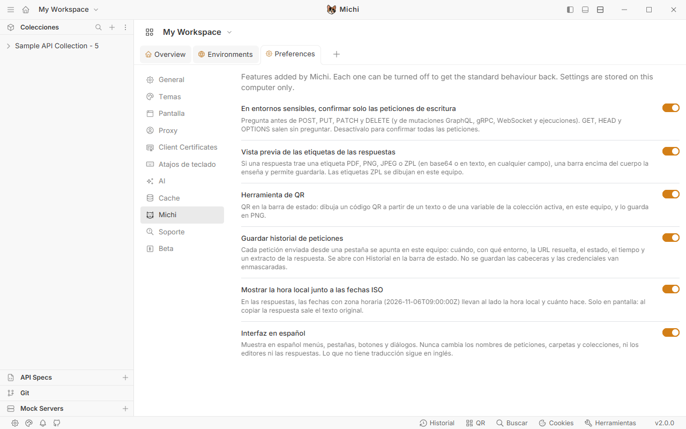
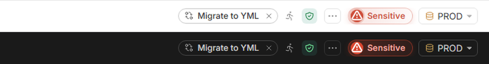
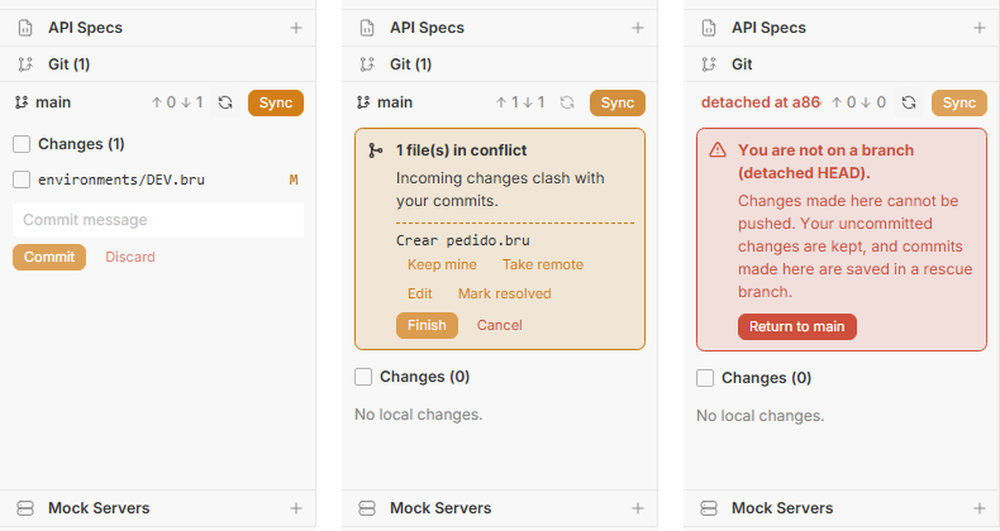
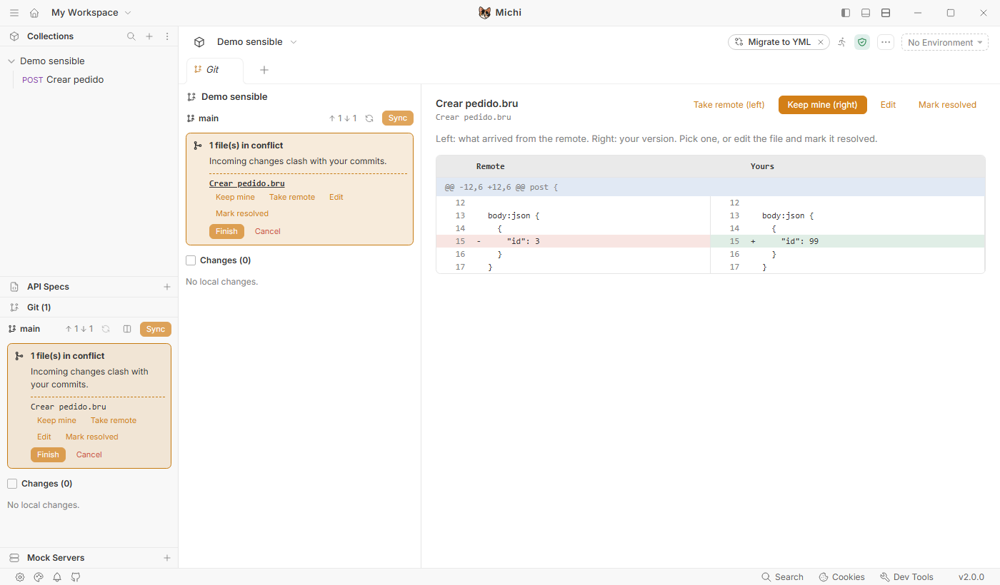
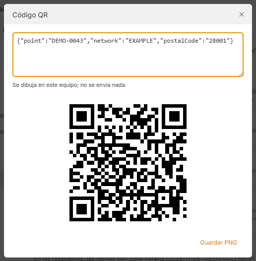

<!-- [FORK H-29] Portada del repositorio en GitHub. El README.md de la raíz es el de Bruno y no se toca. -->

<p align="center">
  
</p>

<h1 align="center">Michi</h1>

<p align="center">
  Cliente de APIs de escritorio basado en <a href="https://github.com/usebruno/bruno">Bruno</a>,
  con lo que nos faltaba para el trabajo diario con colecciones compartidas.
</p>

---

Michi es Bruno 4.3 con algunas funciones añadidas. Abre las mismas colecciones, en `.bru` o en YAML, y no cambia su formato: si un día vuelves al Bruno oficial, todo sigue funcionando igual. Como Bruno, no necesita cuenta ni nube; las colecciones son ficheros de tu disco y se comparten con git.

Por ahora solo hay versión para **Windows**.

## Instalar

Descarga la última versión desde [Releases](../../releases). Hay dos formas de usarla:

- **Instalador** (`Michi-Setup-<versión>.exe`). Crea el acceso directo y la entrada en el menú Inicio. Es la opción para el día a día.
- **Sin instalar** (`Michi-<versión>-sin-instalar.zip`). Descomprímelo donde quieras y abre `Michi.vbs`; la carpeta `Michi` que hay al lado tiene que seguir ahí. La primera vez de cada versión tarda un poco porque prepara la app en tu equipo; después arranca directamente.

Las dos guardan los datos en `%APPDATA%\Michi`, así que puedes pasar de una a otra sin perder nada (pero no las abras a la vez). Michi convive con el Bruno oficial: tiene su propio nombre, su acceso directo y su carpeta de datos.

Los ejecutables no están firmados, así que Windows SmartScreen puede avisar la primera vez: *Más información → Ejecutar de todas formas*. Si quieres comprobar el fichero, cada descarga lleva al lado su `.sha256`:

```powershell
Get-FileHash .\Michi-Setup-4.3.0-fork.11.exe -Algorithm SHA256
```

## Qué añade a Bruno

Todo se puede apagar en **Preferences → Michi**. Esos ajustes se guardan en tu equipo, no en la colección.



### Entornos sensibles

En el detalle de cada entorno hay un interruptor **Sensitive**. Márcalo en producción (o en cualquier entorno donde un envío por error haga daño) y Michi te pedirá confirmación antes de enviar. La ventana enseña el método y la URL ya resuelta, con los valores del entorno, para que veas exactamente adónde va la petición.

Por defecto solo pregunta en las peticiones que escriben (POST, PUT, PATCH, DELETE, mutaciones GraphQL, gRPC, WebSocket y el runner). Las consultas salen sin preguntar.



La marca se guarda en un fichero `.michi.json` en la raíz de la colección. Si lo subes a git, todo el equipo tiene los mismos entornos protegidos. El Bruno oficial ignora ese fichero.

### Panel Git

En la barra lateral hay una sección **Git** para el repositorio de la colección que tienes abierta: rama, cambios sin subir, commits pendientes de traer y la lista de ficheros modificados.

- **Sync** trae y sube cambios sin que tengas que pensar en el orden. Si tienes cambios sin guardar en un commit, los aparta, actualiza y los vuelve a poner.
- Los **conflictos** se resuelven fichero a fichero, viendo a la izquierda lo que llegó del remoto y a la derecha tu versión.
- Si te quedas en *detached HEAD*, un botón te devuelve a tu rama y guarda en otra rama cualquier commit que hubieras hecho ahí.
- Nunca borra trabajo: *Discard* y *Sync* guardan los cambios en *Saved changes*, de donde se pueden recuperar. No hace `push --force`, `reset --hard` ni `rebase`.





### Etiquetas en las respuestas

Si una respuesta trae una etiqueta, aparece una barra encima del cuerpo con un botón **Show**. Michi la busca en cualquier campo de la respuesta, sin importar cómo se llame:

- PDF, PNG o JPEG en base64, que se ven tal cual.
- ZPL (el lenguaje de las impresoras Zebra), en texto o en base64. Se dibuja como imagen y debajo tienes el código.

Cada etiqueta se puede guardar en un fichero. Todo se hace en tu equipo; no se envía nada a servicios externos.

### Códigos QR

El botón **QR** de la barra de estado dibuja un código QR a partir de un texto o de una variable de la colección activa (las que crean los scripts con `bru.setVar` y las del entorno, menos las secretas). Útil cuando una prueba necesita un QR que se lee desde otro dispositivo. Se puede guardar como PNG.



### Paneles de los scripts

Los scripts de respuesta pueden dibujar un panel HTML con `bru.visualize`. Bruno 4.3 dejó de mostrarlos; Michi los enseña como pestañas junto al formato de la respuesta, y **Response** vuelve al cuerpo normal.

```js
bru.visualize('html', { name: 'Resumen', content: '<h1>' + res.getBody().id + '</h1>' });
```

El panel se pinta en un marco aislado: puede llevar sus propios estilos y scripts, pero no tiene acceso a la aplicación.

### Historial de peticiones

El botón **History** de la barra de estado muestra las últimas 300 peticiones que has enviado: cuándo, con qué entorno, la URL resuelta, el estado, el tiempo y un trozo de la respuesta. Se puede filtrar y volver a abrir la petición.

El historial se queda en tu equipo. No guarda las cabeceras, y los valores que parecen credenciales (tokens, contraseñas, claves) aparecen como `***`.

### Hora local junto a las fechas

En las respuestas, al lado de cada fecha con zona horaria (`2026-11-06T09:00:00Z`) aparece en gris la hora local y cuánto hace. Es solo visual: al copiar la respuesta sale el texto original.

### Interfaz en español

Opcional y apagada por defecto. Traduce menús, pestañas, botones y diálogos. No toca los nombres de tus peticiones y carpetas, los editores ni las respuestas. Lo que todavía no está traducido sigue en inglés.

### Sin telemetría

Las versiones de Michi no envían estadísticas de uso.

## Preguntas habituales

**¿Mis colecciones dejan de servir en Bruno si las abro con Michi?**
No. Michi no cambia el formato de los ficheros. Lo único que añade es `.michi.json` (si usas entornos sensibles), y Bruno lo ignora.

**¿Puedo usarlo con la CLI `bru`?**
Sí, las colecciones son las mismas. Lo que añade Michi (confirmaciones, historial, etiquetas…) es de la aplicación de escritorio; la CLI se comporta como siempre.

**¿Es un producto oficial de Bruno?**
No. Es un fork independiente y no está relacionado con el equipo de Bruno. Si algo falla en Michi, abre un issue aquí, no en el repositorio de Bruno.

**¿Cada cuánto se actualiza con Bruno?**
Michi va sobre una versión concreta de Bruno (ahora la 4.3.0). Cuando sale una nueva, se actualiza la base y se publica una versión nueva de Michi. El número de versión lo indica: `4.3.0-fork.11` es la undécima versión de Michi sobre Bruno 4.3.0.

## Compilar desde el código

Hace falta Node.js 22 o posterior y Windows.

```bash
npm ci
node fork/scripts/build-win.mjs
```

El instalador, el portable y el `.zip` del lanzador quedan en `packages/bruno-electron/out/`.

Si vas a tocar el código, lee antes [fork/README.md](../fork/README.md) y la documentación de [fork/docs/](../fork/docs/README.md): explican cómo está separado el código de Michi del de Bruno para que actualizar sea sencillo. Los cambios de cada versión están en [fork/CHANGELOG.md](../fork/CHANGELOG.md).

## Licencia

MIT, igual que Bruno. El código original es de Anoop M D, Anusree P S y los colaboradores de Bruno (ver [LICENSE.md](../LICENSE.md)). Bruno es una marca de sus autores; Michi solo usa su código bajo esa licencia.
