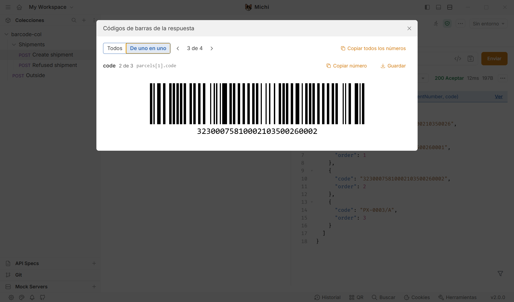

# Códigos de barras de la respuesta

Dibuja como código de barras los valores que trae una respuesta (un número de envío, los números de sus bultos), para leerlos con un lector o una PDA directamente desde la pantalla. Se activa por carpeta, con una variable.

## Activarlo en una carpeta

En los ajustes de la carpeta, pestaña **Vars**, se añade una variable:

| Nombre | Valor |
|---|---|
| `michi.barcodes` | Los campos de la respuesta que se quieren dibujar, separados por comas |

Ejemplo, para una respuesta `{"shipmentNumber": "…", "parcels": [{"code": "…"}, {"code": "…"}]}`:

```
michi.barcodes = shipmentNumber, parcels.code
```

Desde ese momento, todas las peticiones de esa carpeta (y de sus subcarpetas) enseñan una barra azul encima del cuerpo cuando la respuesta trae esos campos: *"3 barcodes in this response (shipmentNumber, code)"* → **Show**.



## Cómo se escriben los campos

| Se escribe | Qué dibuja |
|---|---|
| `shipmentNumber` | El valor de ese campo |
| `sender.reference` | Un campo dentro de otro |
| `parcels.code` | Un código por cada elemento de la lista `parcels` |
| `parcels.0.code` o `parcels[0].code` | Solo el del primer elemento |
| `references` | Si el campo es una lista de textos o números, uno por cada valor |

- Los campos se separan con comas, punto y coma o saltos de línea.
- Un campo que no viene en la respuesta, que viene vacío o que no es un texto ni un número se salta. Si no queda ninguno, la barra no aparece (una respuesta de error, por ejemplo).
- Como mucho se dibujan 100 códigos por respuesta.

## Dónde puede ir la variable

La variable es una variable normal de Bruno, así que vale en la carpeta, en la colección y en una petición suelta. Gana la más cercana a la petición: **petición → carpeta → carpetas de encima → colección**. Sirve para pedir otros campos en una subcarpeta concreta.

Para que una carpeta deje de dibujarlos basta con desmarcar la variable o borrarla.

## La ventana

- **All / One at a time**: todos seguidos o de uno en uno. De uno en uno el código sale más grande y se pasa con las flechas del teclado o con los botones; es la vista cómoda para un lector, que coge el primer código que ve.
- **Copy number** copia el valor; **Copy all the numbers** los copia todos, uno por línea.
- **Save** guarda el código como PNG (`barcode-<valor>.png`) con el mismo diálogo que *Download response*.
- El código se dibuja siempre en negro sobre blanco, con su margen, sea cual sea el tema de la app.

## La sesión: todos los códigos de un tirón

Cada respuesta que llega a una carpeta que pide códigos deja los suyos en la **sesión** de la colección, la envíe una pestaña o un flow. Al crear diez envíos, los diez quedan juntos.

- La barra lo dice a la derecha: *"In this session: 12"* → **Show all** abre la ventana con todos, agrupados por petición y hora.
- **Save all as a page** guarda un HTML con todos los códigos, cada uno con su número, para imprimirlo o enviarlo.
- Un valor que ya está en la sesión no se repite (consultar un envío que se acaba de crear no lo duplica).
- **Clear session** la vacía. Si la respuesta que se está viendo no trae códigos, la barra sigue saliendo mientras la sesión tenga algo.
- La sesión vive en memoria: se pierde al cerrar la app. Guarda como mucho 500 códigos por colección, los más recientes.

**Limpiar también lo que guardan los scripts.** Si los scripts de la colección llevan su propia lista de lo creado en una variable de sesión (`bru.setVar`), una segunda variable de la carpeta dice cuáles olvidar al limpiar:

```
michi.barcodes.clear = history
```

*Clear session* borra entonces esas variables de sesión además de la lista de códigos, y quita los paneles que los scripts de la colección habían pintado (`bru.visualize`), que seguirían enseñando la lista vieja. El siguiente envío empieza las dos listas de cero. Sin esa variable no toca ni variables ni paneles.

## En Flows: códigos de lo que guarda una lista

El informe de una lista (*View report*) tiene el botón **Barcodes** cuando alguna columna trae códigos. Abre la misma ventana con un código por valor.

- Arriba se eligen las columnas a dibujar. De entrada salen marcadas las que parecen códigos: sin espacios, con cifras y de seis caracteres o más.
- Cada código va bajo su elemento de la lista, con su número y el resto de sus datos (*"#3 · Paq 10"*), así se sabe de qué caso es.
- No depende de la variable de carpeta: vale para cualquier lista.

## Detalles

| Tema | Comportamiento |
|---|---|
| Tipo de código | **Code 128**, con los juegos B y C: letras, números y signos corrientes (ASCII imprimible), hasta 80 caracteres. Los tramos de cifras se empaquetan de dos en dos, así un número largo ocupa la mitad |
| Valores que no caben | Un valor con tildes, eñes u otros caracteres fuera de ese juego, o de más de 80 caracteres, se lista con un aviso en lugar del código |
| Dónde se dibuja | En el equipo. No se envía nada a ningún servicio ([seguridad.md](../seguridad.md)) y no se añade ninguna dependencia: el codificador está en `components/fork/Barcodes/code128.js` |
| Formato de la colección | No cambia: la carpeta guarda una variable más, como cualquier otra ([reglas.md](../reglas.md), R-10; [decisiones.md](../decisiones.md), DEC-30) |
| Bruno oficial | Ve una variable que nadie usa. La colección funciona igual |
| Scripts | No hay API nueva: ningún script necesita saber de la variable (R-12) |
| CLI `bru` | No aplica: es solo lo que se ve en la respuesta (R-15) |
| Enganches | Ninguno nuevo. La barra se pinta en el hueco que ya había encima del cuerpo de la respuesta (H-24), debajo de la de etiquetas |
| Desactivar | *Preferences → Michi → Barcodes of response fields*. Activado por defecto: sin la variable no hace nada (R-14) |
| Idioma | Con *Spanish interface* encendido, la barra y la ventana salen en español |

## Ficheros

| Fichero | Qué hace |
|---|---|
| `components/fork/Barcodes/code128.js` | Codificador Code 128 (símbolos, dígito de control y módulos) |
| `components/fork/Barcodes/fields.js` | Lee la variable, con su orden de preferencia, y saca los valores de la respuesta |
| `components/fork/Barcodes/BarcodeImage.js` | El código como SVG |
| `components/fork/Barcodes/png.js` | El código como PNG, para guardarlo |
| `components/fork/Barcodes/index.js` | La barra de la respuesta |
| `components/fork/Barcodes/BarcodeModal.js` | La ventana, común a la respuesta, la sesión y las listas de Flows |
| `components/fork/Barcodes/session.js`, `watch.js` | La sesión de cada colección y quien apunta en ella las respuestas que llegan (instalado desde `ForkRoot.js`) |
| `components/fork/Barcodes/page.js`, `save.js` | La página HTML con todos los códigos y el guardado |
| `components/fork/Barcodes/fromItems.js` | Los códigos de una lista de Flows |
| `components/fork/LabelPreview/index.js` | Monta las dos barras (etiquetas y códigos) en el hueco de H-24 |
