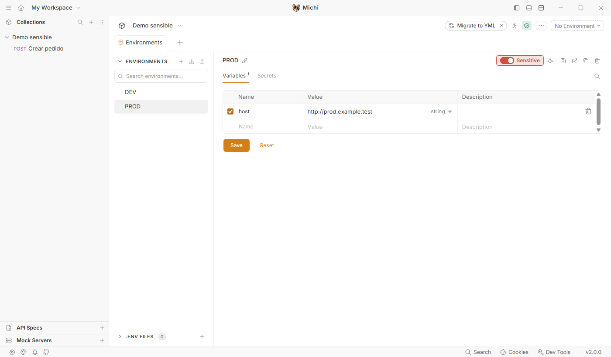
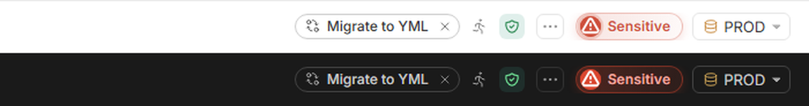
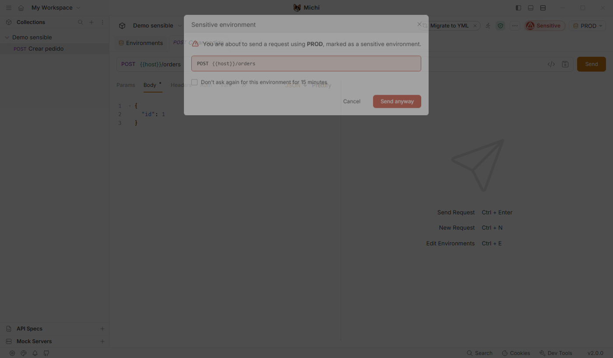

# Función: entornos sensibles

Primera función del fork, publicada en la 4.3.0-fork.1 y ampliada después. En el detalle de cada entorno hay un interruptor **Sensitive**. Si está activado y ese entorno está seleccionado, aparece el aviso **Sensitive** junto al selector de entorno, y los envíos (HTTP, GraphQL, gRPC y WebSocket) y las ejecuciones del runner piden confirmación. Desde la fork.9, por defecto solo se pregunta en las escrituras y la ventana enseña la URL resuelta ([fork-9-a-11.md](fork-9-a-11.md)). Desde la fork.5, la marca se guarda en la colección (`.michi.json`) y la comparte todo el equipo a través de git.

## Instalar

La versión vigente es la 4.3.0-fork.11. Se descarga de las [Releases del repositorio](https://github.com/jgallegs/michi_api/releases):

| Opción | Fichero | Para qué |
|---|---|---|
| Instalador | `Michi-Setup-<versión>.exe` | Uso diario: crea acceso directo y entrada en el menú Inicio |
| Sin instalar | `Michi-<versión>-sin-instalar.zip` | Se descomprime donde se quiera y se abre `Michi.vbs`, con la carpeta `Michi/` al lado. La primera vez de cada versión tarda un poco ("Preparing Michi…") porque descomprime la app en el equipo; después arranca tan rápido como instalada |

- Convive con el Bruno oficial: tiene su propio nombre, acceso directo y carpeta de datos (`%APPDATA%\Michi`). Las colecciones se abren con *Open collection*; son las mismas carpetas que se usan con Bruno.
- No está firmado: Windows SmartScreen puede avisar (*Más información → Ejecutar de todas formas*). Para comprobar el fichero, se compara su hash con el `.sha256` que lo acompaña: `Get-FileHash <fichero> -Algorithm SHA256`.
- Desde la 4.3.0-fork.4 la app se presenta como Michi en todos sus textos, con el logo de la gata. Solo siguen diciendo "Bruno" los enlaces y créditos al proyecto Bruno y lo que se escribe en los ficheros, para que sigan siendo compatibles ([decisiones.md](../decisiones.md), DEC-18).
- Si se instaló alguna versión con el nombre anterior, **Brunillo**, hay que desinstalarla desde *Configuración → Aplicaciones*: Michi es una app distinta y no la sustituye.

Las dos formas comparten los mismos ajustes: son la misma app y guardan sus datos en `%APPDATA%\Michi` (colecciones abiertas, preferencias, secretos de entorno). Se puede pasar de una a otra sin perder nada, pero no deben abrirse a la vez. El lanzador sin instalar descomprime la app una sola vez por versión en `%LOCALAPPDATA%\Michi-portable\<versión>` y a partir de ahí la abre directamente; las versiones antiguas se borran solas (DEC-21).

## Cómo se usa

1. Abrir la configuración de entornos (selector de entorno → *Configure*) y elegir el entorno, por ejemplo `PROD`.
2. Activar el interruptor **Sensitive**, arriba a la derecha.

   

3. Con ese entorno seleccionado, junto al selector se ve el aviso:

   

4. Al enviar, sale la confirmación con el método y la URL de la request (en la captura, anterior a la fork.9, todavía con la plantilla `{{host}}`; ahora sale la URL resuelta):

   

   - **Cancel** tiene el foco: pulsar Enter cancela, no envía.
   - **Send anyway** envía.
   - *Don't ask again for this environment for 15 minutes*: deja de preguntar durante 15 minutos para ese entorno, solo hasta que se cierre la app.

## Qué hay que saber

| Tema | Comportamiento |
|---|---|
| Dónde se guarda | En `.michi.json`, en la raíz de la colección: `{ "sensitiveEnvironments": ["PROD"] }`. Hay que subirlo a git con la colección. No toca `.bru`/`.yml` ni los entornos ([reglas.md](../reglas.md), R-10, R-13) |
| Compartir | Todo el que use Michi con esa colección ve la misma marca. La app relee el fichero antes de cada envío y al volver a la ventana, así que lo que llega con un `git pull` se aplica al momento |
| Bruno oficial | Ignora `.michi.json`, en formato `.bru` y en YAML: la colección funciona igual, solo que sin la protección |
| Migrar a YAML | La migración de Bruno conserva `.michi.json`. Los nombres de entorno no cambian, así que la marca sigue valiendo |
| Marcas antiguas | Las que se hicieron antes de la fork.5 se guardaron en el equipo y se siguen respetando. Al desmarcar un entorno, se quitan de los dos sitios |
| Sin permisos de escritura | Si no se puede escribir `.michi.json`, la marca se guarda solo en el equipo y la app lo avisa |
| Fichero dañado | Si `.michi.json` existe pero no se puede leer (por ejemplo, tras un `git pull` con un conflicto sin resolver), **todos los entornos de la colección cuentan como sensibles** y el aviso del selector lo explica. Mientras tanto no se pueden cambiar las marcas y la app no escribe en el fichero, para no perder lo que hay dentro. Se arregla resolviendo el conflicto a mano (desde la fork.13) |
| Renombrar el entorno | La marca va por nombre: hay que volver a activarla con el nombre nuevo |
| Entornos globales | No incluidos: solo entornos de colección |
| CLI `bru` | No aplica: la marca vive en la app de escritorio ([reglas.md](../reglas.md), R-15) |
| Si la ventana de confirmación no se puede montar | Se usa la confirmación nativa del sistema: una request a un entorno sensible nunca sale sin preguntar |
| Solo escrituras | Con *Confirm only write requests* (activo por defecto, en *Preferences → Michi*), GET, HEAD, OPTIONS y consultas GraphQL salen sin preguntar ([fork-9-a-11.md](fork-9-a-11.md)) |
| Desactivar | Basta con apagar el interruptor del entorno (R-14) |

## Cómo está hecho

- Interfaz y lógica: `packages/bruno-app/src/components/fork/SensitiveEnvironment/` (`store.js`, `guard.js`).
- Lectura y escritura de `.michi.json`: `packages/bruno-electron/src/fork/collection-settings-file.js` (común a todo lo que se guarda en ese fichero) y `sensitive-environments-file.js`, por los canales `fork:sensitive-environments:*` (H-16).
- Enganches H-01 a H-05: interruptor, aviso del selector, `sendRequest`, runner y montaje de la ventana de confirmación (DEC-09).

## Verificación (2026-11-04, Bruno v4.3.0)

- 16 tests propios (`store.spec.js`, `guard.spec.js`) y 265 de Bruno de las zonas tocadas: 281/281 en verde.
- Recorrido real con Playwright sobre la app en modo desarrollo, con una colección de prueba con hosts `*.example.test`, sin salir a ningún entorno real:
  - marcar el entorno muestra el aviso;
  - **Cancel** y **Enter** no envían;
  - **Send anyway** envía;
  - con `DEV` no hay aviso ni confirmación;
  - `git status` de la colección queda limpio después de todo el recorrido (R-13).
- `check-diff`: OK. Solo 13 líneas añadidas en ficheros de Bruno (enganches H-01 a H-05).
- El mismo recorrido pasó sobre el ejecutable empaquetado de la fork.3. La fork.4 se probó en modo desarrollo con un perfil aislado: título "Michi", "About Michi" y ninguna aparición de "Bruno" en el texto visible de la ventana.
- No probado a mano: la confirmación del runner (cubierta solo por tests unitarios).

## Pendiente

- Soporte para entornos globales.
