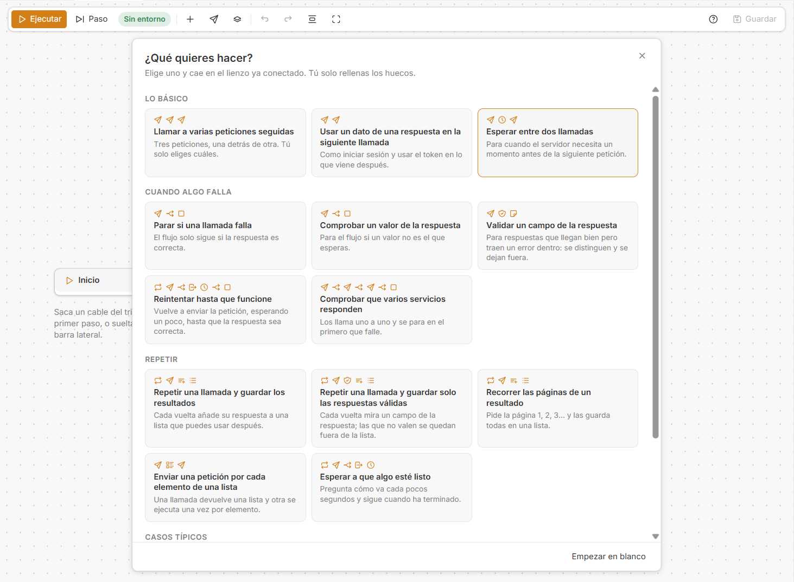
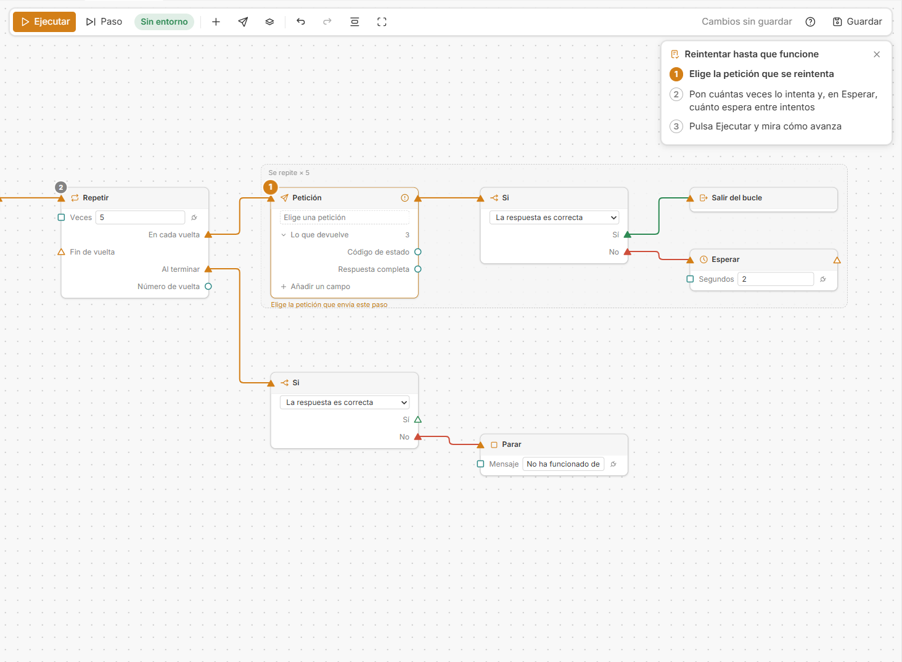
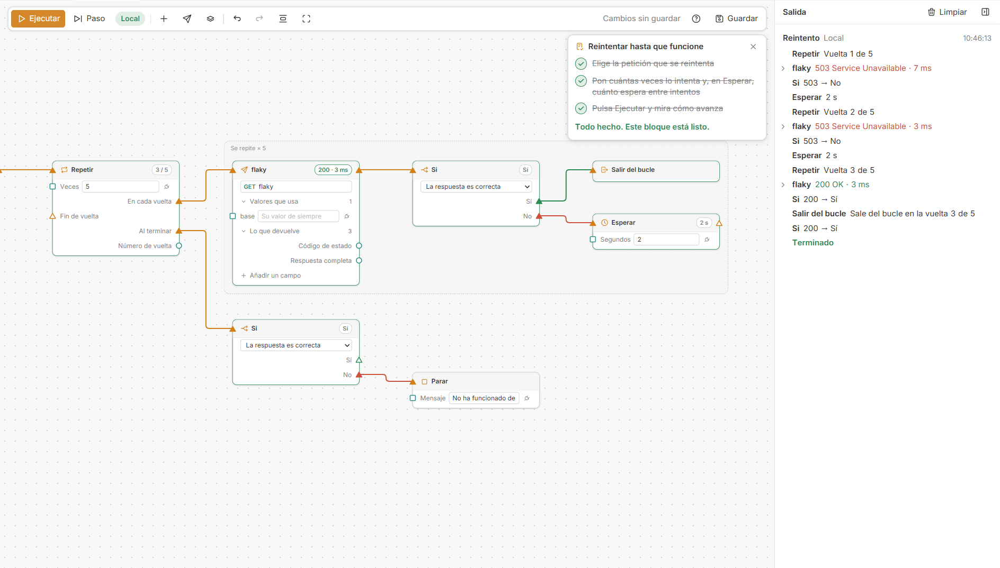
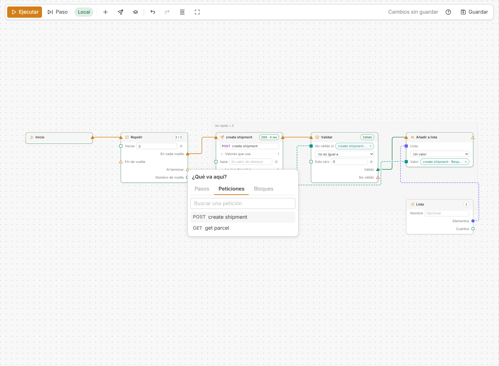
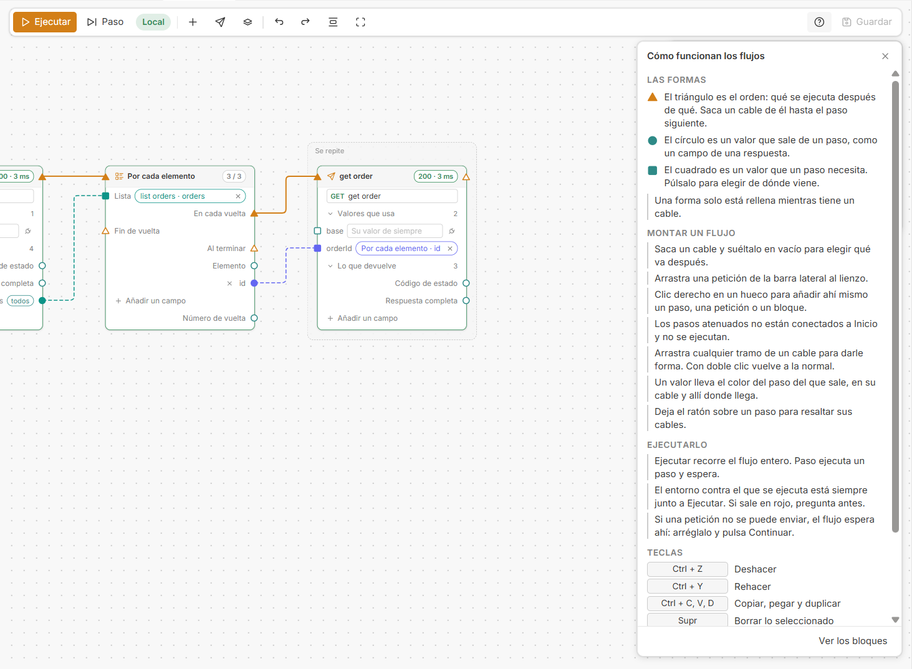
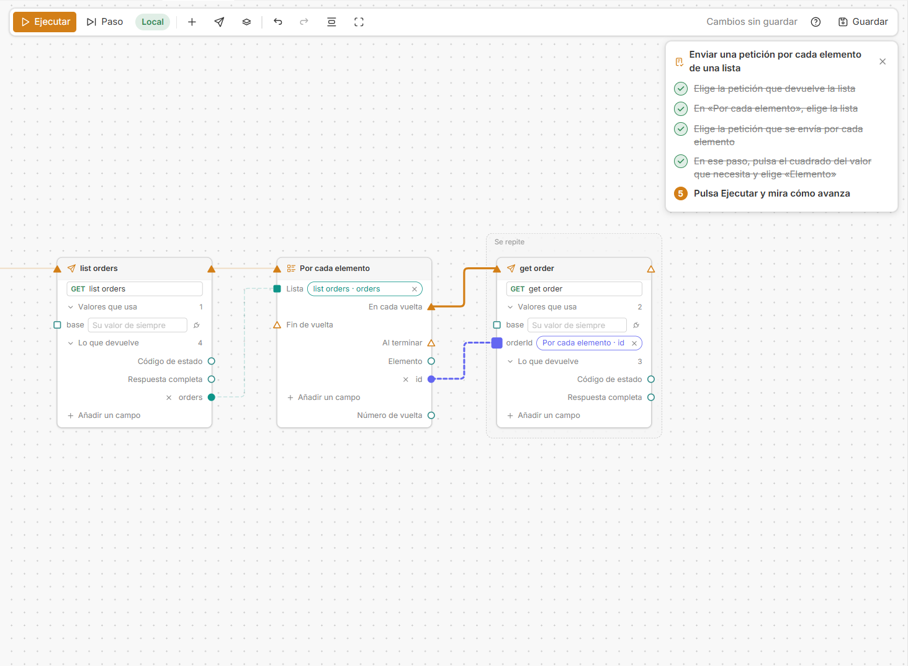
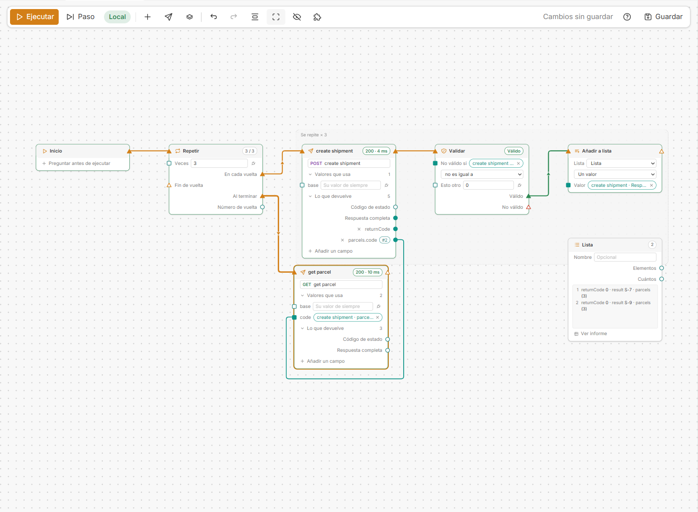
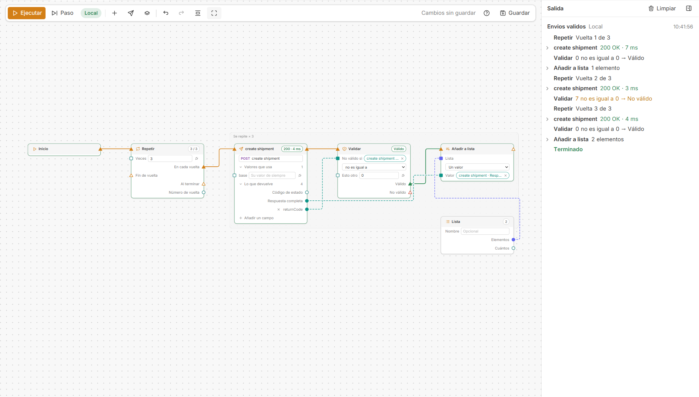
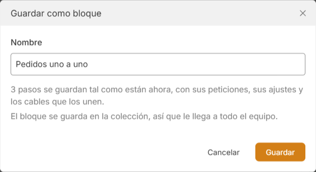
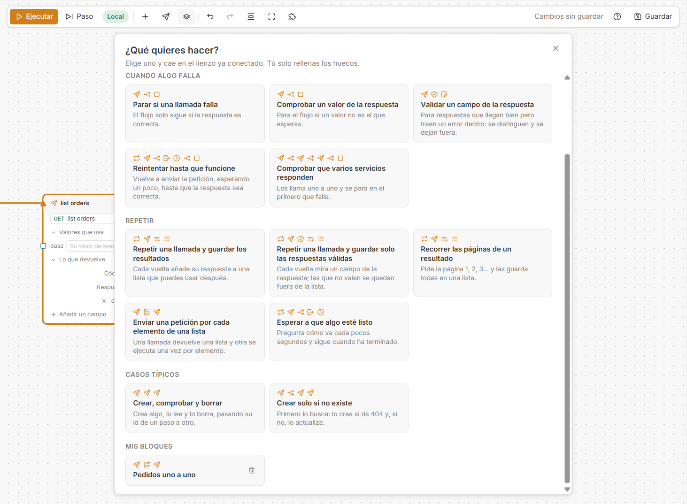

# Guía rápida de Flows

Para quien usa Michi y nunca ha montado un flow. Se lee en cinco minutos y no hace falta saber programar. La referencia completa está en [flows.md](flows.md).

Los nombres de botones y pasos son los de la interfaz en español. Si la tienes en inglés, entre paréntesis va el nombre original la primera vez que sale.

## Antes de empezar

En *Preferencias → Michi* enciende **Flujos** (*Flows*) y, si quieres la app en español, **Interfaz en español** (*Spanish interface*). Aparece la sección **Flujos** en la barra lateral.

Un flow encadena peticiones que ya tienes en la colección. Si la petición todavía no existe, créala primero como siempre.

## Tu primer flow en un minuto

1. En la sección **Flujos**, pulsa **+** y ponle un nombre.
2. El flow se abre preguntando **¿Qué quieres hacer?** Elige una tarjeta, por ejemplo *Llamar a varias peticiones seguidas*.

   

3. Los pasos caen en el lienzo ya unidos. Arriba a la derecha sale la lista de lo que falta, y cada paso lleva encima el número de lo que le toca.

   

4. Haz lo que dice cada punto. Se tachan solos, y el lienzo se mueve hasta el paso siguiente.
5. Mira que el entorno que sale junto a **Ejecutar** (*Run*) es el que quieres y pulsa **Ejecutar**. A la derecha, en **Salida**, se ve cada paso con su código y su tiempo.

   

6. **Guardar** lo deja en la colección para todo el equipo.

Si prefieres empezar sin bloque, pulsa **Empezar en blanco**. La galería vuelve cuando quieras con el botón **Bloques**.

## Añadir cosas al flow

Hay tres clases de cosas, y cada una tiene su lista:

| Qué | Dónde |
|---|---|
| **Pasos** (Si, Validar, Repetir, Esperar…) | Botón **Añadir paso** |
| **Peticiones** de la colección, por carpetas | Botón **Añadir petición** |
| **Bloques** ya montados | Botón **Bloques** |

- **Clic derecho** en un hueco del lienzo ofrece las tres, y lo que elijas cae donde estaba el puntero.
- Si tiras de un **triángulo** y sueltas el cable en vacío sale la misma lista, con sus tres pestañas, y lo que elijas queda ya unido.

## Qué bloque elijo

| Quiero… | Bloque | Lo que relleno |
|---|---|---|
| Lanzar varias peticiones, una detrás de otra | Llamar a varias peticiones seguidas | Qué tres peticiones |
| Iniciar sesión y usar el token después | Usar un dato de una respuesta en la siguiente llamada | Las dos peticiones y qué valor pasa de una a otra |
| Dar tiempo al servidor entre dos llamadas | Esperar entre dos llamadas | Las dos peticiones y los segundos |
| Que el flow no siga si algo responde mal | Parar si una llamada falla | La petición |
| Asegurarme de que un valor es el que espero | Comprobar un valor de la respuesta | La petición, el valor y lo que debería valer |
| Dejar fuera las respuestas que llegan bien pero traen un error dentro | Validar un campo de la respuesta | La petición, el campo que hay que mirar y el valor que significa que no vale |
| Insistir hasta que una llamada funcione | Reintentar hasta que funcione | La petición, cuántos intentos y cuánto espera |
| Ver que varios servicios están vivos | Comprobar que varios servicios responden | Una petición por servicio |
| Hacer la misma llamada varias veces y quedarme con todo | Repetir una llamada y guardar los resultados | La petición y cuántas veces |
| Repetir una llamada y quedarme solo con las que salieron bien | Repetir una llamada y guardar solo las respuestas válidas | La petición, el campo que hay que mirar, el valor que no vale y cuántas veces |
| Traer todas las páginas de un listado | Recorrer las páginas de un resultado | La petición y de dónde sale el número de página |
| Hacer una llamada por cada elemento de un listado | Enviar una petición por cada elemento de una lista | La petición que da la lista, dónde está la lista y la petición que se repite |
| Esperar a que un proceso termine | Esperar a que algo esté listo | La petición que dice cómo va y el valor que significa "listo" |
| Probar el ciclo completo de un recurso | Crear, comprobar y borrar | Las tres peticiones y el id que pasa de una a otra |
| Crear algo solo si todavía no está | Crear solo si no existe | La petición que busca, la que crea y la que actualiza |

Un bloque es un punto de partida: después puedes añadir, quitar o cambiar pasos como en cualquier flow.

## Leer el lienzo

- **Triángulo:** el orden. De dónde sale un cable es lo que va antes; adonde llega, lo que va después.
- **Círculo:** un valor que sale de un paso, como un campo de la respuesta.
- **Cuadrado:** un valor que un paso necesita.
- Una forma está rellena solo si tiene un cable.
- Un paso **atenuado** no está unido a **Inicio** y no se ejecuta. Sirve para dejar piezas de reserva.
- Un paso con **aviso naranja** dice debajo lo que le falta. Mientras haya avisos, **Ejecutar** no envía nada.
- Lo que un **Repetir** repite queda dentro de un marco.
- **Colores de los cables:** naranja es el orden; **verde** lo que sale de *Sí* o *Válido* y **rojo** lo que sale de *No* o *No válido*. Los valores llevan el color del paso del que salen, y ese mismo color lo tienen la entrada y la ficha a las que llegan.
- Deja el ratón sobre un paso y sus cables se resaltan mientras los demás se apagan: es la forma rápida de seguir un flow con muchos cables.

El botón **?** de la barra abre este mismo resumen dentro de la app, con las teclas.

## Pasar un valor de un paso a otro

Es lo que más se hace: el token del login, el id de lo que se acaba de crear.

1. En el paso que necesita el valor, pulsa su **cuadrado**.
2. Sale la lista de valores de los demás pasos. Elige uno.
3. Si el campo todavía no sale porque esa petición no se ha enviado nunca, **escribe su nombre** en el buscador (`token`, `pedido.id`) y elígelo en el paso del que viene.

El paso enseña de dónde toma el valor en una ficha, y se quita con su aspa.

## Coger un dato concreto de la respuesta

*Respuesta completa* es el cuerpo entero. Para un solo dato, pulsa **Añadir un campo** en la petición y elígelo: sale como una salida más.

La lista ya trae los campos aunque no hayas ejecutado el flow:

- Los que se vieron la última vez que se envió esa petición, **desde un flow o desde su pestaña de siempre**. Michi los recuerda de un día para otro (solo los nombres, nunca los valores).
- Los que declara el **Swagger** del servicio, si lo tienes abierto en **API Specs**. Salen marcados *de la especificación*.
- Los que menciona el **script** de la petición. Salen marcados *del script*.

Si aun así no está, escribe su nombre: `datos.numero`.

**Si el dato está dentro de una lista** (el código de un bulto dentro de la lista de bultos), el campo coge el del primer elemento y lo dice con una ficha `#1`. Púlsala para elegir **El primer elemento**, **El último elemento** o escribir la posición que quieras: `3` es el tercero.

Para hacer algo con **todos** los elementos, usa el paso **Por cada elemento**.

## Cuando llega un 200 con un error dentro

Hay servicios que contestan 200 y dentro traen un código que dice que no se hizo nada. Para que el flow no trate esa respuesta como buena está el paso **Validar**:

1. Ponlo detrás de la petición.
2. Pulsa el cuadrado de **No válido si** y elige el campo que hay que mirar, por ejemplo el código de retorno.
3. Elige la comparación y escribe el valor: *no es igual a* `0`.
4. De **Válido** saca lo que usa la respuesta (guardarla en una lista, la llamada siguiente). De **No válido**, lo que quieras que pase en ese caso, o nada.

Dentro de un **Repetir**, si de **No válido** no cuelga nada, esa vuelta se acaba ahí y empieza la siguiente: la respuesta mala no se guarda y el flow sigue.

## Ejecutar

| Botón | Qué hace |
|---|---|
| **Ejecutar** | Recorre el flow entero desde **Inicio** |
| **Paso** (*Step*) | Ejecuta un paso y espera, para ir viéndolo despacio |
| **Parar** | Corta la ejecución, también una petición a medias |
| **Continuar** | Sigue desde donde se quedó |

- El entorno contra el que se ejecuta está siempre junto a **Ejecutar**. Si sale en **rojo** es un entorno sensible y la app pide confirmación antes de enviar nada.
- Una respuesta 404 o 500 **no detiene** el flow: es una respuesta. Para reaccionar a ella está el paso **Si**.
- Si una petición no se puede enviar, por ejemplo porque no hay conexión, el flow se queda en ese paso. Se arregla y se pulsa **Continuar**.

## Guardar tus propios bloques

Cuando tengas unos pasos que vas a repetir en otros flows, como tu login con su petición ya elegida:

1. Selecciónalos arrastrando sobre el fondo, o con `Ctrl` + clic.
2. Pulsa **Guardar como bloque** y ponle un nombre.

   

3. Desde entonces sale en la galería, bajo **Mis bloques**, para ti y para todo el que tenga la colección.

   

Se borra desde la propia galería, con la papelera de su tarjeta.

## Si algo no sale

| Qué ves | Qué pasa | Qué hacer |
|---|---|---|
| Un paso atenuado | No está unido a **Inicio** | Saca un cable del triángulo del paso anterior hasta él |
| *Elige la petición que envía este paso* | El paso no tiene petición | Pulsa **Elige una petición** dentro del paso |
| *Petición no encontrada* | La petición se movió o cambió de nombre | Vuelve a elegirla en el paso |
| *No ha llegado ningún valor para…* en la salida | El campo no venía en la respuesta | Despliega la respuesta en la salida y mira cómo se llama de verdad el campo |
| *Este paso necesita una lista…* | A **Por cada elemento** le llega algo que no es una lista | Elige el campo que contiene la lista, no la respuesta completa |
| *Salir del bucle solo funciona dentro de un bucle* | El paso está fuera del marco de un **Repetir** | Únelo a un paso de dentro del marco |
| El nombre del entorno en rojo | Es un entorno sensible | Comprueba que es el que quieres antes de confirmar |
| No encuentro un paso en el buscador | — | Se puede buscar por su nombre en español o en inglés |

## Teclas

| Tecla | Qué hace |
|---|---|
| `Ctrl + Z`, `Ctrl + Y` | Deshacer y rehacer |
| `Ctrl + C`, `Ctrl + V`, `Ctrl + D` | Copiar, pegar y duplicar |
| `Supr` | Borrar lo seleccionado |
| `Ctrl + A` | Seleccionar todo |
| `Ctrl + S` | Guardar |
| `Ctrl + Enter` | Ejecutar |
| Botón derecho, arrastrando | Mover el lienzo |
| Rueda del ratón | Acercar y alejar |
