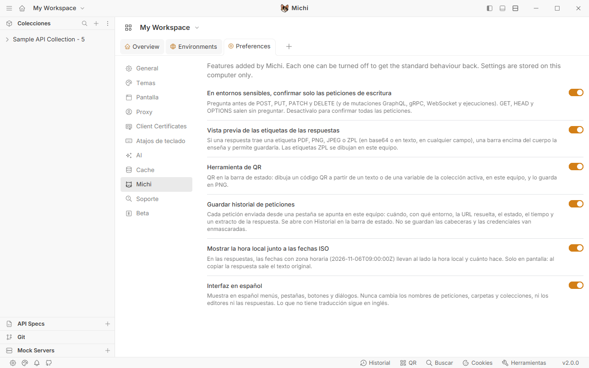
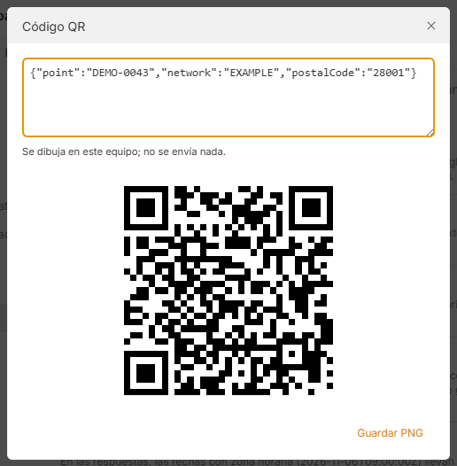

# Funciones de las versiones fork.9 a fork.11

La 4.3.0-fork.9 trae una pestaña **Preferences → Michi** con un interruptor por función y estas mejoras: vista previa de **etiquetas** (PDF/PNG/JPEG/ZPL) en las respuestas, **historial de requests**, **hora local** junto a las fechas ISO, una **barrera de entornos sensibles** que solo pregunta en escrituras y enseña la URL resuelta, e **interfaz en español** (apagada por defecto). Además, la app no envía telemetría. La fork.10 añade el dibujo del ZPL y la herramienta de **QR**, y la fork.11 vuelve a mostrar los **paneles de `bru.visualize`**.

## Preferences → Michi

Pestaña en *Preferences* (icono de la gata). Cada función del fork tiene su interruptor y se puede apagar para volver al comportamiento de Bruno ([reglas.md](../reglas.md), R-14). Los valores se guardan en el equipo (`localStorage`, clave `michi.settings`), no en la colección.



| Interruptor | Por defecto |
|---|---|
| Confirm only write requests in sensitive environments | Activado |
| Preview labels found in responses | Activado |
| QR code tool | Activado |
| Show script panels (bru.visualize) | Activado |
| Keep a request history | Activado |
| Show local time next to ISO dates | Activado |
| Spanish interface | Desactivado |

Cada función nueva añade su entrada en `components/fork/settings/registry.js`.

## Vista previa de etiquetas

Si la respuesta trae una etiqueta, aparece una barra azul encima del cuerpo: *"2 labels in this response (PDF, ZPL)"* → **Show**.

- Busca en cualquier campo de la respuesta: no depende del nombre. Detecta PDF, PNG y JPEG en base64 (también con `data:...;base64,` o con saltos de línea) y ZPL en base64 o en texto.
- El PDF se ve pintado, página a página. El ZPL se dibuja desde la fork.10 (texto, códigos de barras y QR), con el tamaño de `^PW`/`^LL` o 4×6" a 203 ppp; el código queda debajo, en *ZPL code*.
- **Save** guarda cada etiqueta (`label-1.pdf`, `label-2.zpl`…) con el mismo diálogo que *Download response*.
- No sale a ningún servicio externo ([seguridad.md](../seguridad.md)).

## Historial de requests

Botón **History** en la barra de estado (abajo a la derecha, junto a *Search*).

- Guarda las últimas 300 peticiones enviadas desde una pestaña: hora, entorno, método, URL ya resuelta, estado, tiempo, tamaño y un extracto de la respuesta (1000 caracteres).
- Filtro por palabras (todas deben aparecer): `post 500`, `orders`…
- Al pulsar una fila se ve el detalle, y **Open request** abre la petición si la colección sigue abierta.
- Seguridad: solo se guarda en el equipo (`localStorage`, clave `michi.history`); no guarda cabeceras y enmascara (`***`) los valores con nombre de token, clave, contraseña, secreto, auth o firma, en la URL y en el extracto, además de `Bearer ...` y `Basic ...`. *Clear history* lo borra.
- El runner no se apunta: tiene su propio informe.

## Hora local junto a las fechas ISO

En el cuerpo de la respuesta, cada fecha con zona horaria (`2026-11-06T09:00:00Z`, `...+01:00`) lleva al lado, en gris, la hora local y cuánto hace: `6/11/26, 10:00:00 · hace 3 horas`.

- Solo es visual: al copiar la respuesta sale el texto original.
- Las fechas sin zona (`2026-11-06T09:00:00`) no se tocan, porque ya son hora local.
- Solo en editores de solo lectura (respuestas); no aparece mientras se escribe.
- Es un complemento global de CodeMirror (`components/fork/LocalTime`), montado desde `ForkRoot` (H-05).

## Barrera de entornos sensibles: mejoras

Sobre lo descrito en [entornos-sensibles.md](entornos-sensibles.md):

- La confirmación enseña la URL resuelta, con los valores del entorno (`https://api.example.test/orders`), no la plantilla `{{host}}/orders`.
- Con *Confirm only write requests* activo, solo pregunta en escrituras: POST, PUT, PATCH, DELETE, mutaciones GraphQL, gRPC, WebSocket y ejecuciones del runner. GET, HEAD, OPTIONS y consultas GraphQL salen sin preguntar. Si se apaga, pregunta siempre, como antes.

## Interfaz en español

Con *Spanish interface* activo, menús, pestañas, botones y diálogos pasan a español (*Cabeceras*, *Cuerpo*, *Nueva petición*, *Preferencias*…). Al apagarlo vuelve el inglés sin reiniciar.

- Nunca cambia nombres de peticiones, carpetas, colecciones ni pestañas, ni editores, valores de los campos o respuestas.
- Lo que no está en el diccionario sigue en inglés. Las frases están en `packages/bruno-app/src/components/fork/SpanishUi/phrases.js`.
- Por eso va desactivada por defecto: es una capa por encima de Bruno, no una traducción completa.

## Sin telemetría ni promociones

- Las builds del fork dejan vacía la clave de analítica de Bruno (plugin de compilación, H-11), así que la app no envía el aviso diario de uso, se compile donde se compile.
- Bruno 4.3 no enseña promociones de pago en la app: el único componente (*Golden Edition*) no está montado. No había nada que ocultar.

## Herramienta de QR (fork.10)

Botón **QR** en la barra de estado, junto a *History*.



- El texto se escribe o se elige de una variable de la colección activa: las de runtime (las que ponen los scripts con `bru.setVar`) y las del entorno activo, salvo las secretas.
- El QR se dibuja en el equipo (corrección de errores M, con el comando `^BQ` de ZPL) y **Save PNG** lo guarda.
- No usa ningún servicio externo para generar el código: el contenido no sale del equipo.
- Admite hasta unos 2.300 bytes de texto.

## Paneles de los scripts (fork.11)

Bruno 4.3 sigue aceptando `bru.visualize` en los scripts, pero no enseña nada, así que los paneles que dibujaban las colecciones dejaron de verse. Desde la fork.11, Michi los enseña como pestañas junto al formato de la respuesta; **Response** vuelve al cuerpo normal (DEC-24).

```js
bru.visualize('html', { name: 'Resumen', content: '<h1>' + res.getBody().id + '</h1>' });
```

- Funciona en los scripts de respuesta, en modo seguro y en modo desarrollador.
- El panel se pinta en un iframe aislado (`sandbox="allow-scripts"`): puede llevar estilos y scripts, pero no toca la aplicación.
- Se apaga en *Preferences → Michi* (*Show script panels*).
- Recorrido: `bruno-js/src/fork/visualize.js` guarda los paneles (H-31 a H-33), Electron los envía a la ventana por el canal `main:fork-visualizations` (H-34) y `components/fork/Visualizations` los pinta (H-35 y H-36).

## Cómo dibuja sin internet

Usa `@zebrash/browser` 1.0.4 (MIT, [decisiones.md](../decisiones.md), DEC-22). Esa librería descarga sus fuentes de jsDelivr; el plugin de compilación `plugins/fork/zebrash-fonts.mjs` cambia ese cargador por las fuentes que ya trae el paquete, incrustadas, y la compilación falla si el bundle conserva la URL del CDN. Comprobado en la app empaquetada: ninguna petición a internet al dibujar.

Desde la fork.12, la fuente condensada en negrita (fuente 0 de ZPL) es **Fira Sans Condensed Bold** (SIL Open Font License 1.1, junto a su licencia en `components/fork/LabelPreview/fonts/`). La que trae el paquete, `HelveticaBoldCondensedCustom.ttf`, tiene un aviso de copyright de Adobe con todos los derechos reservados: no se distribuye, y la compilación falla si llega al bundle (DEC-25). Licencias de todo lo que añade el fork: [fork/THIRD-PARTY-NOTICES.md](../../THIRD-PARTY-NOTICES.md).

## Enganches

| ID | Fichero de Bruno | Qué hace |
|---|---|---|
| H-05 (cambia) | `pages/Main.js` | Monta `ForkRoot`: confirmación, hora local y español |
| H-22, H-23 | `components/Preferences/index.js` | Pestaña y panel *Michi* |
| H-24 | `components/ResponsePane/QueryResult/index.js` | Barra de etiquetas |
| H-25 | `providers/ReduxStore/index.js` | Middleware del historial |
| H-26 | `components/StatusBar/index.js` | Botones del fork en la barra de estado: *History* y, desde la fork.10, *QR* |
| H-27, H-28 (fork.10) | `packages/bruno-app/package.json`, `package-lock.json` | Dependencia `@zebrash/browser` (tipo `dependencias`) |
| H-31 a H-33 (fork.11) | `packages/bruno-js/…` | `bru.visualize` en el entorno de scripts y en el resultado del script de respuesta |
| H-34 (fork.11) | `packages/bruno-electron/src/ipc/network/index.js` | Envía los paneles a la ventana |
| H-35, H-36 (fork.11) | `components/ResponsePane/index.js`, `components/ResponsePane/QueryResult/index.js` | Pestañas de los paneles y el iframe |

Las rutas de `bruno-app` son relativas a `packages/bruno-app/src/`. El detalle de cada enganche está en [fork/HOOKS.md](../../HOOKS.md).

## Verificación

- fork.9 (2026-11-06): 70 tests propios del fork y 431 en las zonas tocadas (fork, barra de estado, store, panel de respuesta), todo en verde. `check-diff`: OK. App empaquetada con perfil aislado: arranca; botón *History* en la barra de estado y su ventana; pestaña *Michi* en Preferencias con sus interruptores; con *Spanish interface* la barra de estado sale como *Historial · Buscar · Cookies · Herramientas*.
- No probado a mano: la barra de etiquetas y la hora local con una respuesta real de un servicio, ni el instalador NSIS.

## Pendiente

- Entornos globales en la barrera de entornos sensibles.
