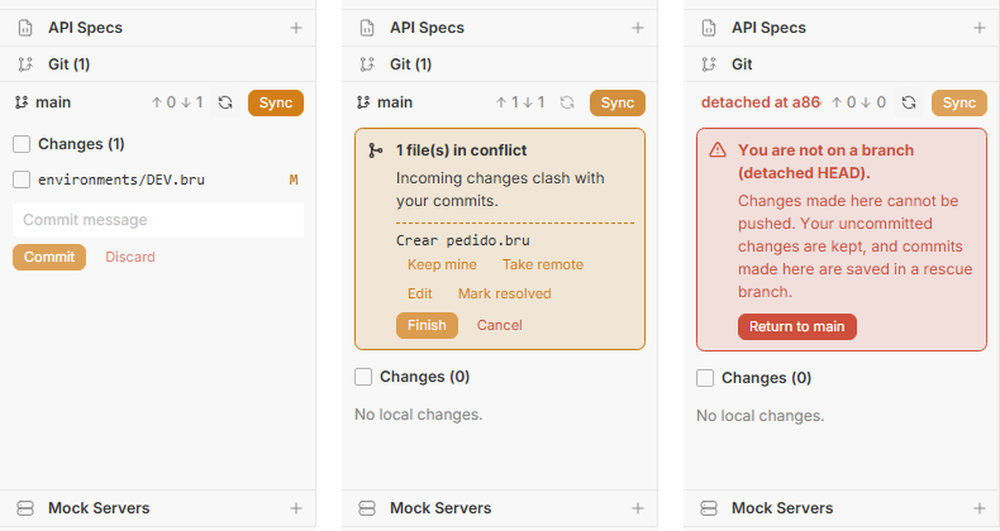
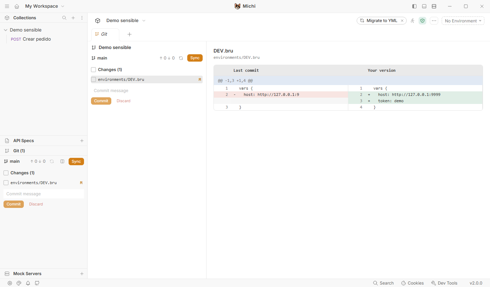
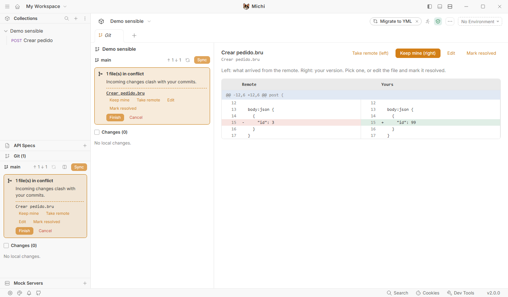

# Función: panel Git

Publicada en la 4.3.0-fork.7 (panel) y la 4.3.0-fork.8 (vista en pestaña). En la barra lateral de Michi hay una sección **Git** para el repositorio de la colección abierta. Muestra la rama, si va por delante o por detrás del remoto y qué ficheros han cambiado. Un botón **Sync** trae y sube cambios sin perder nunca trabajo. Si hay conflictos, guía para resolverlos, y si el repositorio está en *detached HEAD*, lo saca con un clic.

*De izquierda a derecha: un cambio local con un commit nuevo en el remoto, un conflicto guiado y el aviso de detached HEAD.*

## Vista grande (desde la fork.8)

Con el botón de columnas del panel (*Open the Git view*), o haciendo clic en cualquier fichero de la lista, se abre una **pestaña Git**: el panel a la izquierda y, a la derecha, el diff a dos columnas del fichero elegido (*Last commit* frente a *Your version*).

En un **conflicto**, la misma vista enseña lo que llegó del remoto a la izquierda y la versión propia a la derecha, con los botones encima: *Take remote (left)*, *Keep mine (right)*, *Edit* y *Mark resolved*. Así se decide viendo exactamente qué cambia cada uno.

## Qué problemas resuelve

| Problema | Qué hace el panel |
|---|---|
| Ficheros modificados por todos lados sin saber cuáles | La lista **Changes**: clic en un fichero para ver exactamente qué ha cambiado |
| No se puede hacer pull porque hay cambios | **Sync** los guarda aparte, trae lo nuevo y los vuelve a poner |
| El repositorio se queda en detached HEAD | Aviso rojo y **Return to main**. Si se habían hecho commits ahí, los guarda en una rama `rescued-…` para que no se pierdan |
| Conflictos que se quedan a medias | Por cada fichero: **Keep mine**, **Take remote**, **Edit** y **Mark resolved**. Después, **Finish** o **Cancel** (vuelve a como estaba) |
| Algo borrado sin querer | **Discard** no borra: guarda los cambios en **Saved changes**, de donde se pueden recuperar |

## Cómo se usa

1. Abrir la sección **Git** de la barra lateral. Si hay varias colecciones abiertas, elegir cuál arriba.
2. Antes de empezar a trabajar, pulsar **Sync**.
3. Al terminar algo: marcar los ficheros, escribir el mensaje y pulsar **Commit**. Después, **Sync** para compartirlo.
4. Si sale el aviso de conflicto, ir fichero por fichero:
   - **Keep mine**: se queda la versión propia entera.
   - **Take remote**: se queda la del remoto.
   - **Edit**: abre el fichero para mezclar a mano. Hay que borrar las marcas `<<<<<<<`, `=======` y `>>>>>>>` y pulsar **Mark resolved**. Michi no deja continuar si quedan marcas.
   - Al terminar, **Finish** y luego **Sync**.
5. Si algo no cuadra, **Cancel** devuelve todo a como estaba antes del conflicto. Los cambios sin commit quedan en **Saved changes**.

## Qué hace Sync por dentro

1. Comprueba que no hay conflictos pendientes ni detached HEAD. Si los hay, se para y lo dice.
2. `git fetch --prune`, así que siempre compara con lo último del remoto.
3. Si la rama va por detrás: guarda los cambios sin commit (stash `michi: local changes before sync`), intenta un *fast-forward* y, si no se puede, hace merge. Si el merge choca, se para con los conflictos listos para resolver.
4. Vuelve a poner los cambios guardados. Si chocan con lo que ha llegado, también se para y deja resolverlo.
5. Si hay commits sin subir, hace `push`. Si la rama no existe en el remoto, la publica.

Nunca hace `push --force`, `reset --hard` ni `rebase`, y no se queda colgado pidiendo contraseña por consola (usa el gestor de credenciales del sistema).

## Saved changes

Lista de los stashes que crea Michi (empiezan por `michi:`): los cambios apartados por un Sync que no se pudieron volver a poner y los descartes. **Restore** los vuelve a aplicar y **Delete** los borra definitivamente, con confirmación.

## Límites

- No cambia de rama ni crea ramas (salvo la de rescate). Está pensado para trabajar todos en `main`, como en [colecciones-en-equipo.md](../colecciones-en-equipo.md).
- No tiene historial ni gráfico de commits.
- *Keep mine* y *Take remote* toman el fichero entero. Para mezclar línea a línea, se usa *Edit*.
- Muchos conflictos falsos vienen de los saltos de línea (Windows/Linux). El `.gitattributes` de [colecciones-en-equipo.md](../colecciones-en-equipo.md) (C-40) es lo que más reduce los "ficheros modificados por todos lados".

## Cómo está hecho

- Electron: `packages/bruno-electron/src/fork/git/git-service.js`, que usa `simple-git` (ya venía con Bruno), y `git-ipc.js`, que registra los canales `fork:git:*` (enganche H-17).
- Interfaz: `packages/bruno-app/src/components/fork/SourceControl/` (H-18 en la barra lateral). La pestaña Git (`GitTab.js`, con `diffRows.js` y `SideBySideDiff.js`) usa los enganches H-19 a H-21.
- Inspirado en el panel de [ColdBru](https://github.com/nicandcranny/coldbru) (MIT), pero escrito de nuevo sobre Bruno 4.3.0: ColdBru se basa en una versión anterior de Bruno y no gestionaba fetch, detached HEAD ni conflictos. No se ha copiado su código (DEC-20).
- Probado (2026-11-04): 16 escenarios (con el diff de conflicto en los dos sentidos) con repositorios git reales (un remoto y dos clones) en `git-service.spec.js`; 4 tests de interfaz; y el recorrido completo en la app con Playwright: cambio local más commit remoto, commit y push, conflicto con *Keep mine* y salida de detached HEAD. En la fork.8, el mismo recorrido desde la pestaña: diff a dos columnas y conflicto con el remoto a la izquierda y la versión propia a la derecha.
